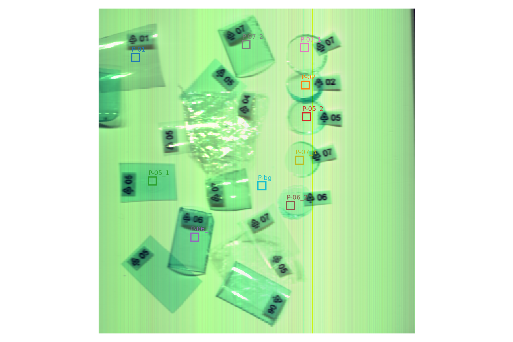
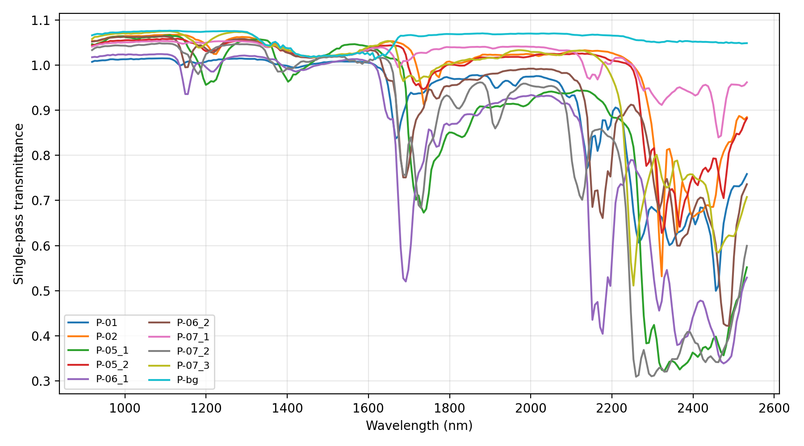
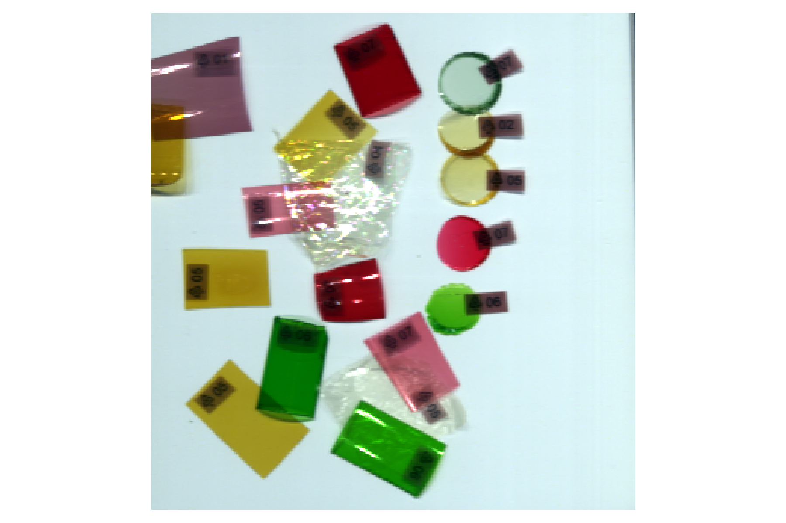
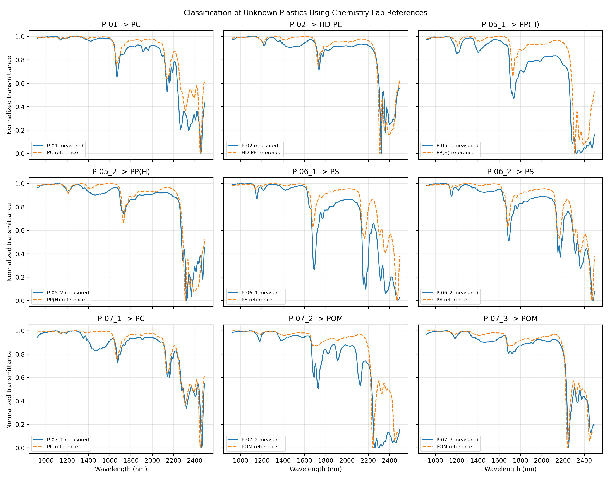

# Plastic Classification from SWIR Hyperspectral Images

This project classifies unknown plastic samples from SWIR hyperspectral data
using reference transmittance spectra measured in the Chemistry Lab.

## Method

1.Spectral measurment of unkown plastic
2. Apply white/dark reference correction.
3. Estimate single-pass transmittance from the white-background measurement.
5. Compare normalized spectra of unknown-plastic with known Chemistry Lab references.
6. Create an optimized false-color SWIR image using bands with high visual
   separation.

## Results

| Selected unknown-plastic ROIs | ROI transmittance spectra |
|---|---|
|  |  |
| The scanner image with the unknown-plastic ROIs marked for analysis. | Single-pass transmittance spectra extracted from the selected ROIs. |

| Optimized SWIR visualization | Unknown-to-reference classification |
|---|---|
|  |  |
| False-color SWIR composite using bands selected for strong variation. | Each unknown-plastic compared with its closest known Chemistry Lab plastic reference. |

## Run

Install the required packages:

```bash
pip install matplotlib numpy pandas spectral
```

Run:

```bash
python Plastic_classificationl.py
```

The script writes result images to `Result/`.

## Data

The dataset is not included because of its large file size. Put SWIR scan and known-plastic
reference CSV files, and place them in this local structure:

```text
data/
├── ir plastics_scan_0552/
│   ├── ir plastics_scan_0552.png
│   └── capture/
│       ├── ir plastics_scan_0552.hdr
│       ├── ir plastics_scan_0552.raw
│       ├── WHITEREF_ir plastics_scan_0552.hdr
│       ├── WHITEREF_ir plastics_scan_0552.raw
│       ├── DARKREF_ir plastics_scan_0552.hdr
│       └── DARKREF_ir plastics_scan_0552.raw
└── Transmittance/
    ├── HD-PE-transmittance.Sample.Raw.csv
    ├── PC-transmittance.Sample.Raw.csv
    ├── POM-transmittance.Sample.Raw.csv
    ├── PP(H)-transmittance.Sample.Raw.csv
    └── PS-transmittance.Sample.Raw.csv
```

```bash
python Plastic_classificationl.py
```

If your files use different names or ROI locations, update `scan_name`,
`reference_files`, or `rois` in the script.
